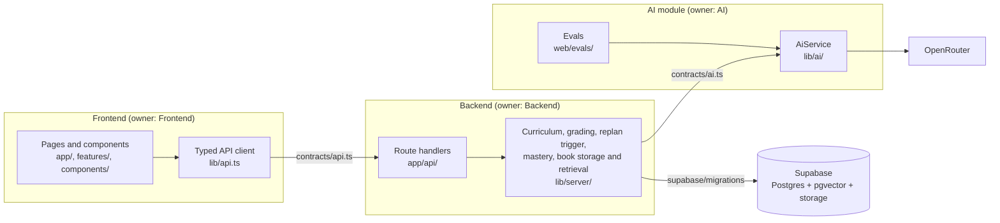

# Architecture

A children's learning app for the US market; everything the product shows or generates is in English. A parent or child describes a goal ("my child got a B in algebra"), and the app builds a curriculum that repairs itself as the child learns, adapts to the child across subjects, and can ground its lessons in an uploaded textbook.

Three people build it: **Frontend**, **Backend** and **AI**. This document and the files in [web/src/contracts/](web/src/contracts/) define where one person's work ends and the next begins. If something you need is not in a contract, change the contract first (see [Changing a contract](#changing-a-contract)).

## Stack

| Layer | Choice |
|---|---|
| App | Next.js (App Router, TypeScript), one repo, deployed on Vercel |
| Database | Supabase: Postgres, pgvector, file storage |
| Models | OpenRouter, called through its OpenAI-compatible API; the model for each task is configurable |
| Embeddings | `openai/text-embedding-3-small` through OpenRouter's embeddings endpoint |
| Validation | Zod, used for API bodies, model outputs and shared types |

## System



There are three boundaries, and each has one contract file:

| Boundary | Contract | What it fixes |
|---|---|---|
| Frontend to Backend | [web/src/contracts/api.ts](web/src/contracts/api.ts) | Every endpoint's request and response |
| Backend to AI | [web/src/contracts/ai.ts](web/src/contracts/ai.ts) | The `AiService` interface and the shapes models must produce |
| Backend to Database | [supabase/migrations/0001_init.sql](supabase/migrations/0001_init.sql) | Tables, columns, allowed values |

[web/src/contracts/domain.ts](web/src/contracts/domain.ts) holds the vocabulary all three share: entity shapes, enum values and the tuning constants.

## Ownership

| | Frontend | Backend | AI |
|---|---|---|---|
| Owns | `app/` (except `app/api/`), `features/`, `components/`, `lib/api.ts` | `app/api/`, `lib/server/`, `supabase/` | `lib/ai/`, `web/evals/` |
| Builds against | `web/src/contracts/api.ts` | all three contracts | `web/src/contracts/ai.ts` |
| Never touches | the database, `lib/ai/` | prompts, model choice | the database, HTTP routes |

Rules that keep the parts fitting together:

1. **The browser only talks to `/api`.** No Supabase client in frontend code.
2. **The AI module is pure.** It receives everything as arguments and returns validated objects. It does not read or write the database. This is what lets evals run the production code path unchanged.
3. **The backend never writes a prompt and never parses raw model text.** It calls `AiService` and gets typed objects back.
4. **Types come from the contracts.** Nobody redeclares a `Lesson` or a `Question` locally; import or derive it.
5. **Code decides when, models decide what.** Grading, the replan trigger, lesson ordering and mastery arithmetic are plain code in the backend. Models write outlines, lessons, diagnoses and notes.

### Working in parallel from day one

- **Frontend** builds against mock responses that satisfy the schemas in `web/src/contracts/api.ts`.
- **Backend** builds against a fake `AiService` that returns canned objects.
- **AI** builds and evaluates `lib/ai/` with fixture inputs, with no backend running.

Integration then means swapping the mock and the fake for the real thing.

## Data model

Defined in full in [supabase/migrations/0001_init.sql](supabase/migrations/0001_init.sql).

| Table | Purpose |
|---|---|
| `child` | Name, grade level, and free-text learner notes |
| `curriculum` | One goal for one child; subject, title, replan state |
| `lesson` | One row per lesson, ordered by `position`; outline fields plus generated `content` |
| `attempt` | One quiz submission, with per-question results |
| `skill_mastery` | A 0 to 1 score per child, subject and skill |
| `replan_event` | A record of each self-healing change, for display |
| `book`, `book_chunk` | Uploaded textbooks, their section map and their embedded chunks |
| `llm_call` | Model, latency and token counts for every model call |

Two ideas carry the design:

- **A curriculum is an ordered list of lesson rows.** Self-healing inserts and appends rows; it never regenerates the whole curriculum.
- **Skills are the common key.** Each lesson lists the skills it teaches, each quiz question names one skill, and mastery is tracked per skill. A wrong answer therefore points at a specific skill.

A lesson has a `kind`:

| Kind | Meaning |
|---|---|
| `core` | Part of the plan: the original outline, or lessons added by "Keep going" |
| `remedial` | Inserted to teach a skill the child is missing |
| `retry` | A failed lesson scheduled again, with fresh content |
| `extension` | Appended because the child is excelling |

The current lesson is the one with the lowest `position` that has no `completed_at`. A lesson is completed by any attempt, whatever the score: a poor score is handled by replanning, not by blocking.

## Flows

### Create a curriculum

1. Frontend sends `POST /api/curricula` with the child, the prompt and an optional book.
2. Backend builds the `LearnerProfile` from `child.notes` and `skill_mastery`. If there is a book, it loads the book's section map (`book.sections`).
3. Backend calls `generateOutline`. The model returns a subject, a title and lesson outlines (title, objective, skills). No lesson bodies. The plan is as long as the goal needs: 4 to 6 lessons for one narrow skill, 8 to 14 for a school unit, up to `MAX_OUTLINE_LESSONS` (30) for a whole subject. With a book, each lesson also names the section it is taught from, stored in `lesson.book_section_index`.
   - If the prompt is too vague to plan ("help with math"), `generateOutline` returns up to 3 clarifying questions instead. Backend stores nothing and responds with `status: 'needs_clarification'`. Frontend shows the questions and sends the same request again with the answers in `clarifications`; with answers present the result is always an outline, so there is one round at most.
4. Backend stores the curriculum and its lessons with `content_status = 'pending'`, responds, and starts generating the first lesson in the background.

### Keep going on a finished plan

1. When every lesson is done, the plan page and the last results screen offer "Keep going". Frontend sends `POST /api/curricula/:id/extend`.
2. Backend takes the replan claim (`replan_status = 'running'`), so a second press or a running replan answers `conflict`, and refuses while a lesson is unfinished or the plan already holds `MAX_CURRICULUM_LESSONS`.
3. Backend calls `extendOutline` with the goal, every lesson of the plan with its latest score, the `LearnerProfile` and, with a book, the section map. The model returns the next lessons: a return to a skill that is still shaky, then what naturally follows; with a book, its untaught sections in order.
4. Backend appends up to `MAX_EXTEND_LESSONS` of them as `core` lessons, releases the claim, starts generating the first and responds with the curriculum. No `replan_event` is written.

### Open a lesson

1. Frontend sends `GET /api/lessons/:id` and polls until `contentStatus` is `ready`.
2. If the content is `pending`, the backend marks it `generating`, fetches the lesson's book chunks (see [Textbook grounding](#textbook-grounding-rag)), calls `generateLesson` and stores the result.
3. When a lesson becomes ready, the backend starts generating the next one, so the child rarely waits.
4. Responses never include `correctIndex` or `explanation`.

### Lesson content and interactive blocks

A lesson is `bodyMarkdown`, a list of `blocks` and the quiz `questions` (`LessonContent` in `contracts/domain.ts`). The body is a full lesson (about 350 to 1,200 words, by grade) and a block sits where the body has a line holding only its id, `[[graph-1]]`.

| Block | What the child does |
|---|---|
| `graph` | A coordinate plane with points, segments, lines, vectors, circles, polygons and function curves. `parameters` are sliders; every position is an expression over them (`"2*m + b"`), so the figure redraws as a slider moves. A point whose coordinates are two parameter names can be dragged. `readouts` show live values. |
| `number_line` | Points (closed or open) and shaded ranges on a line. |
| `check` | A quick question between two ideas, answered in place with feedback per choice. Not graded, not stored; its answer is sent to the browser. |
| `steps` | A worked example opened one step at a time. |

- **The model writes data, our components draw it.** No model-written HTML or SVG reaches the page (ADR 0002). Expressions are parsed by `lib/expr.ts`, never evaluated as code.
- **Three layers check a block.** The AI module converts the model's flat output to `LessonBlock`s and sends a broken block back once with the reason; if it is still broken, the lesson is kept without it. The backend bounds the text and drops any block that fails `lib/lesson-blocks.ts`, together with its placeholder. The frontend shows nothing for a placeholder with no block.
- Lessons stored before blocks existed have no `blocks` field; it reads as `[]`.

### Submit a quiz

1. Frontend sends `POST /api/lessons/:id/attempts`.
2. Backend grades in code against the stored answers, stores the attempt, marks the lesson completed and updates `skill_mastery` for each skill in the quiz.
3. Backend applies the replan rule (below) and responds immediately with results, explanations and `replanTriggered`.
4. In the background it refreshes the learner notes and, if triggered, runs the replan.

### Self-healing (replan)

**Rule.** Take the attempts made since the last replan. Once there are 3, average their scores:

- below 0.6: `struggling`
- 0.9 or above: `excelling`
- otherwise: no change

**When struggling:**

1. Backend sets `replan_status = 'running'` and calls `replan` with the recent attempts (including each wrong answer and its skill) and the remaining outline.
2. The model returns a diagnosis (the mistakes made and the skills missing) and new remedial lesson outlines.
3. Backend inserts, directly after the current position: the remedial lessons, then a `retry` copy of each failed lesson. It renumbers the lessons after them.
4. Backend writes a `replan_event`, sets `last_replan_at` and returns `replan_status` to `idle`.

**When excelling:** the same, except the model returns `extension` lessons and the backend appends them at the end.

The frontend polls `GET /api/curricula/:id` while `replanStatus` is `running`, then shows the new lessons and the diagnosis from the latest `replanEvent`.

### Evolution

After each attempt, for each skill in the quiz:

```
mastery = 0.7 * mastery + 0.3 * (share of that skill's questions answered correctly)
```

A skill starts at 0.5. The AI module also rewrites `child.notes`, a short description of how the child learns. Both go into every `generateOutline`, `generateLesson` and `replan` call as the `LearnerProfile`, across all subjects. A child who aced biology and struggled in algebra therefore gets a deeper biology curriculum and a gentler algebra one next time.

To stop skill names drifting ("linear-equations" and "solving-linear-equations"), the backend passes the child's existing slugs as `knownSkills` and the prompts tell the model to reuse them.

### Textbook grounding (RAG)

1. Frontend uploads a PDF in three requests, because a request to an API route on Vercel is capped at 4.5 MB and a textbook is larger: `POST /api/books/uploads` returns an `uploadId` and a short-lived `uploadUrl` in file storage; the browser sends the file there with `PUT`; `POST /api/books` with the title and the `uploadId` then checks the stored file (a PDF of 20 MB or less) and responds with `status: 'processing'`.
2. In the background the backend extracts the text and calls `prepareBook`. The AI module splits the text into chunks at headings, asks a model for the book map (the ordered list of sections, each with a chapter, a title and a summary), assigns every chunk to a section and embeds the chunks. Backend stores the map in `book.sections` and the chunks in `book_chunk`.
3. **A curriculum is planned from the map, not from a similarity search.** The nearest few chunks to a goal are scattered passages; the map is the book's actual structure. `generateOutline` receives the whole map as `bookSections` and ties each lesson to one section.
4. **A lesson is written from its section.** If the section has at most `LESSON_CHUNK_LIMIT` chunks, the backend passes all of them. Otherwise it embeds the lesson's title and objective and calls `match_book_chunks` with the section index for the nearest `LESSON_CHUNK_LIMIT`. Either way the chunks go into `sourceChunks` in reading order (by `chunk_index`).
5. A lesson with no section (a remedial or extension lesson) searches the whole book the same way, without the section index. A retry lesson keeps the section of the lesson it repeats.

Retrieval is always scoped to one book by `book_id`, so one family's upload never reaches another's lessons. Each book belongs to the parent who uploaded it and is listed only for them (see [Accounts](#accounts)).

## Accounts

Parents sign up and sign in through `/api/auth/*`; the backend calls Supabase Auth and keeps the session in two httpOnly cookies scoped to `/api`, so the browser still only talks to `/api` and never sees a token. Every other endpoint needs a session (401 otherwise). Children and books have an `owner_id`; curricula, lessons and attempts belong to the parent through the child. A request for another family's data answers 404. See ADR 0004.

## Models and evals

- All model calls go through one OpenRouter client in `lib/ai/`.
- `lib/ai/models.ts` maps each task (`outline`, `extend`, `lesson`, `replan`, `learner_notes`, `book_map`, `feedback`) to a default model. Every `AiService` function accepts a `model` override.
- Structured output uses `response_format` with `type: "json_schema"` and `strict: true`, generated from the Zod schemas in `web/src/contracts/ai.ts`. Requests set `provider.require_parameters: true` so OpenRouter only routes to endpoints that support it.
- Enforcement differs between providers, so every response is still parsed with Zod. On failure the function retries once, then throws.
- Model-facing schemas stay plain (no optional fields, no length or range limits) so they work across providers. Counts and ranges are checked in code.
- Evals in `web/evals/` call the same `AiService` functions over fixture inputs, once per candidate model, and compare schema pass rate, latency, token use and output quality. The `onCall` hook reports each call; in production the backend writes those records to `llm_call`.

## Repository layout

The Next.js app lives in `web/`. Paths in this document such as `app/api/` and `lib/ai/` are relative to `web/src/`, and are imported with the `@/` alias (for example `@/contracts/api`).

```
web/src/app/            pages                       Frontend
web/src/app/api/        route handlers              Backend
web/src/features/       page-level UI               Frontend
web/src/components/     shared UI components        Frontend
web/src/lib/api.ts      typed API client            Frontend
web/src/lib/server/     services, database access   Backend
web/src/lib/ai/         AiService implementation    AI
web/src/contracts/      shared contracts            everyone
web/evals/              eval scripts and fixtures   AI
supabase/migrations/    database schema             Backend
```

## Changing a contract

A change to anything in `web/src/contracts/` or `supabase/migrations/` goes in its own pull request, separate from feature work, and is approved by the owner on each side of the boundary it touches before anyone builds on it. Schema changes are new migration files; `0001_init.sql` is not edited once it has been applied to the shared database.

## Out of scope for the MVP

- **Row-level security policies.** All database access is server-side with the service role key; RLS is on with no policies, so Supabase's client roles see nothing (ADR 0003). Ownership is checked in the backend (ADR 0004).
- **Streaming lesson text.** Lessons are generated ahead of time and fetched by polling.
- **Free-text answers.** Quizzes are multiple choice with 4 options, graded in code.
- **Scanned textbooks.** Only PDFs with a text layer are supported.
- **Email verification.** Accounts are created confirmed.
- **Other languages.** English only.

## Known risks

- **Background work on Vercel.** Lesson generation, replans and book ingestion run after the response using Next.js `after()`. They are bound by the function's maximum duration, so a large book may not finish. If that happens, ingest books with a local script instead.
- **Duplicate generation.** Two requests can both see a lesson as `pending`. The backend must claim the lesson with a conditional update (`pending` to `generating`) and only generate if the update changed a row.
- **Stuck states.** If a background job dies, a lesson can stay `generating` or a curriculum `running`. The backend should treat either as failed after a timeout.
