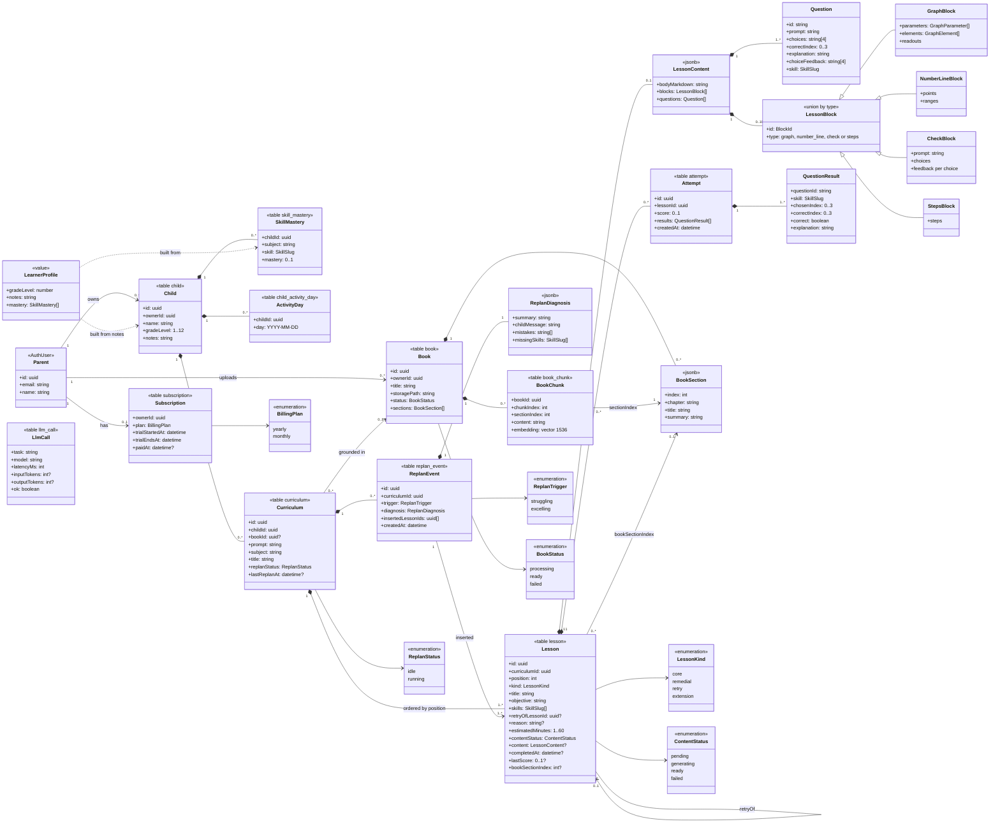
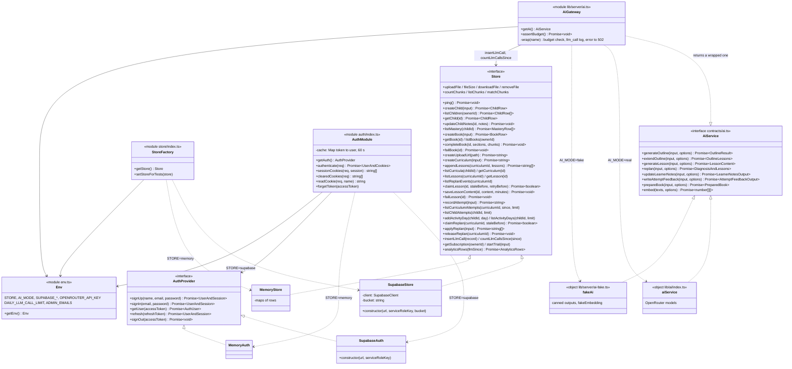
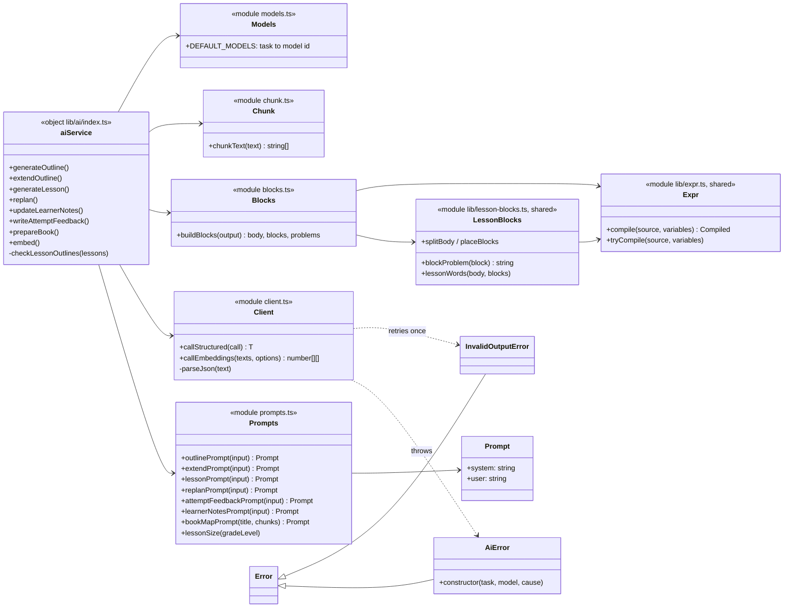
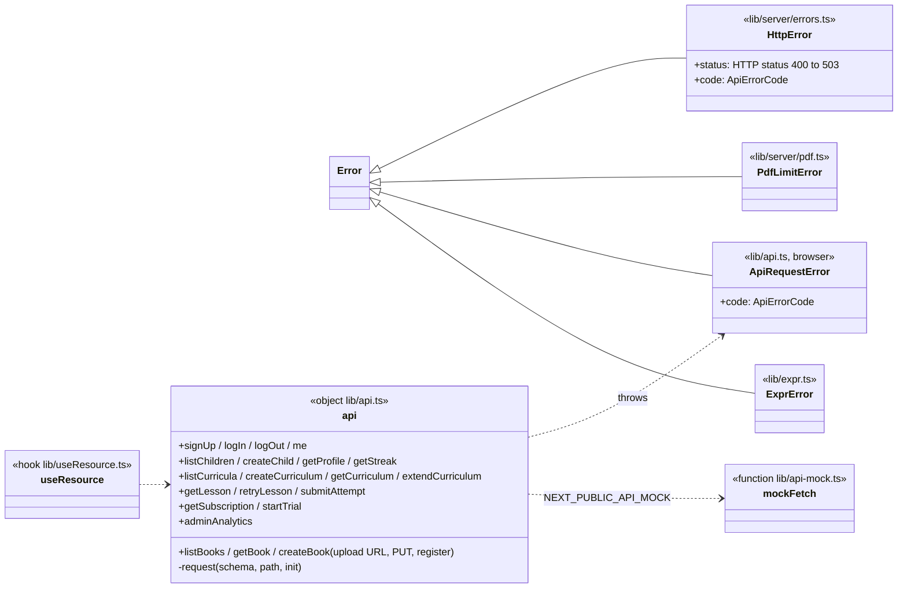

# Class diagrams

The code is TypeScript with few classes: most types are Zod schemas, and most backend logic lives in modules of plain functions. The diagrams therefore show three kinds of box:

- `<<interface>>`: a TypeScript interface with more than one implementation (a port).
- `<<module>>`: a file of exported functions, drawn as a class whose methods are those functions.
- plain boxes: data shapes from `contracts/` and `lib/server/store/types.ts`, or real `class`es.

Paths are relative to `web/src/`. See [component-diagram.md](component-diagram.md) for how the parts fit together.

## 1. Domain model

The entities of `contracts/domain.ts` and the tables of `supabase/migrations/` they are stored in. Multiplicities follow the foreign keys.

Skills are the common key: a `Lesson` lists the skills it teaches, each `Question` names one, `QuestionResult` carries it into the attempt, and `SkillMastery` is updated per skill.

## 2. Ports and adapters (backend)

The three interfaces the backend depends on, their implementations, and the factories that choose one from the environment.

All three factories keep one instance on `globalThis`, so dev hot reload keeps the in-memory data, and each has a `set...ForTests` hook.

## 3. Backend service modules

What each `lib/server` module exports and what it calls. Route handlers in `app/api/` call only the top row.

```mermaid
classDiagram
  direction TB

  class Http {
    <<module http.ts>>
    +route(handler, options) Handler
    +adminRoute(handler, options) Handler
    +publicRoute(handler, options) Handler
    +parseJson(req, schema)
    +parseWith(schema, value)
    +ok(schema, data, status) Response
    +errorResponse(err, req) Response
    -assertSameOrigin(req)
  }
  class RateLimit {
    <<module rate-limit.ts>>
    +LIMITS
    +rateLimit(key, rule)
  }
  Http --> RateLimit
  Http --> AuthModule

  class AuthModule {
    <<module auth/index.ts>>
    +authenticate(req)
  }

  class Curricula {
    <<module curricula.ts>>
    +createCurriculum(user, body) CreateCurriculumResponse
    +extendCurriculum(user, id) Curriculum
    +listCurricula(user, childId)
    +getOwnedCurriculum(user, id) Curriculum
    +validateOutline(outline, ...) ValidOutline
  }
  class Lessons {
    <<module lessons.ts>>
    +getLesson(user, lessonId) GetLessonResponse
    +retryLesson(user, lessonId) GetLessonResponse
    +startLessonGeneration(lessonId, retryNow) boolean
    +generateLessonContent(lessonId)
    +claimLessonForGeneration(id) boolean
    +checkLessonContent(content) LessonContent
    +readContent(row) LessonContent
  }
  class Attempts {
    <<module attempts.ts>>
    +submitAttempt(user, lessonId, body, timeZone) SubmitAttemptResponse
  }
  class Books {
    <<module books.ts>>
    +createBookUpload(user) CreateBookUploadResponse
    +receiveBookUpload(user, uploadId, req)
    +createBook(user, input) Book
    +ingestBook(bookId)
    +checkPreparedBook(prepared)
    +listBooks(user) / getBook(user, id)
  }
  class Children {
    <<module children.ts>>
    +createChild(user, input) Child
    +listChildren(user) Child[]
    +buildLearnerProfile(childId) LearnerProfile
    +knownSkillsOf(profile) string[]
  }
  class Subscription {
    <<module subscription.ts>>
    +startTrial(user, plan) Subscription
    +getSubscription(user)
    +fullAccess(user) boolean
  }
  class Streak {
    <<module streak.ts>>
    +recordActivity(childId, timeZone)
    +getStreakDays(user, childId) string[]
    +timeZoneOf(req) / localDay(tz)
  }
  class Analytics {
    <<module analytics.ts>>
    +getAdminAnalytics() AdminAnalyticsResponse
  }

  class Grading {
    <<module grading.ts, pure>>
    +gradeAttempt(content, answers) score and results
    +skillScores(results) Map
    +nextMastery(previous, skillScore) number
  }
  class Replan {
    <<module replan.ts>>
    +maybeStartReplan(curriculumId) ReplanTrigger
    +runReplan(curriculumId, trigger)
    +refreshLearnerNotes(childId)
    +startLearnerNotesRefresh(childId)
    +summarizeAttempt(attempt, lesson)
  }
  class ReplanPlan {
    <<module replan-plan.ts, pure>>
    +decideReplan(scores) ReplanTrigger
    +planReplan(input) insertAt and NewLesson[]
    +cleanDiagnosis(d) ReplanDiagnosis
  }
  class Feedback {
    <<module feedback.ts>>
    +attemptFeedback(input) AttemptFeedback
    +fallbackFeedback(results) AttemptFeedback
  }
  class Retrieval {
    <<module retrieval.ts>>
    +chunksForLesson(lesson, curriculum, lessons) string[]
    +sectionFor(lesson, lessons) number
  }
  class Pdf {
    <<module pdf.ts>>
    +extractPdfText(bytes) string
    +isPdf(bytes) boolean
  }
  class Access {
    <<module access.ts>>
    +ownedChild(user, id) ChildRow
    +ownedBook(user, id) BookRow
    +ownedCurriculum(user, id)
    +ownedLesson(user, id)
  }
  class Mappers {
    <<module mappers.ts>>
    +toCurriculum(...) Curriculum
    +toLessonSummary(row, fullAccess) LessonSummary
    +toReplanEvent(row) ReplanEvent
  }
  class Background {
    <<module background.ts>>
    +runInBackground(name, job)
    +flushBackground()
  }
  class SharedAccess {
    <<module lib/access.ts, shared>>
    +hasFullAccess(subscription, now) boolean
    +lessonLocked(position, fullAccess) boolean
  }

  Curricula --> Access
  Curricula --> Children
  Curricula --> Lessons
  Curricula --> Subscription
  Curricula --> Mappers
  Lessons --> Access
  Lessons --> Retrieval
  Lessons --> Children
  Lessons --> Subscription
  Lessons --> Background
  Attempts --> Access
  Attempts --> Grading
  Attempts --> Lessons
  Attempts --> Replan
  Attempts --> Feedback
  Attempts --> Streak
  Attempts --> Subscription
  Replan --> ReplanPlan
  Replan --> Lessons
  Replan --> Children
  Replan --> Background
  Books --> Access
  Books --> Pdf
  Books --> Background
  Subscription --> SharedAccess
  Mappers --> SharedAccess
  Streak --> Access
```

Every module in this diagram reaches the database through `getStore()` and models through `getAi()` (diagram 2); those arrows are left out to keep it readable.

## 4. AI module

Each `AiService` method builds a prompt, calls `callStructured` with the Zod schema from `contracts/ai.ts` (sent as `response_format: json_schema, strict`), parses and checks the answer, sends it back once with the reason if it fails, and returns a typed object. It never touches the database.

## 5. Errors and the frontend client

`http.ts` turns an `HttpError` into the `ApiError` JSON envelope with its status; any other error becomes a generic 500. In the browser, `api.request` parses every response with the schema from `contracts/api.ts` and throws `ApiRequestError` with the same `code`.
