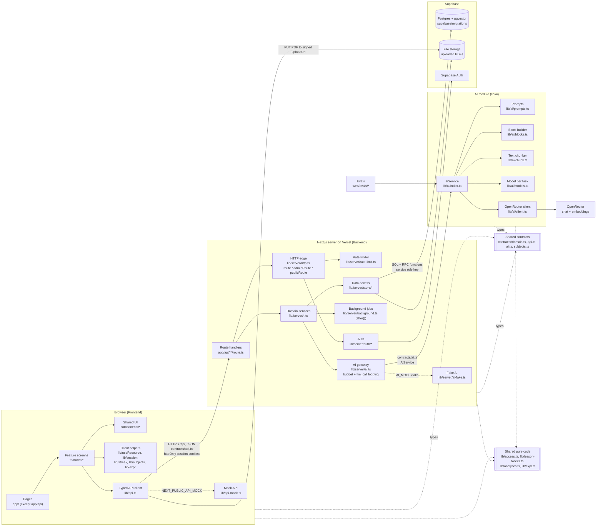
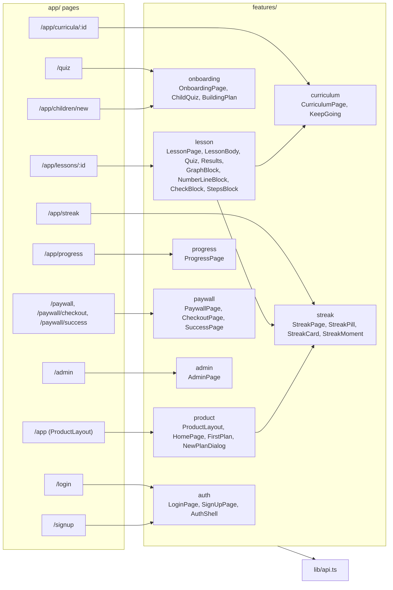

# Component diagram

How Mendly is split into deployable parts and modules, and which way the calls go. Paths are relative to `web/src/` unless they start with `web/` or `supabase/`. For the reasoning behind the split, see [ARCHITECTURE.md](../../ARCHITECTURE.md); for the classes and interfaces inside each part, see [class-diagram.md](class-diagram.md).

## System overview

Solid arrows are runtime calls; dotted arrows are compile-time imports or switches chosen by an environment variable.

## Backend services

The route handlers are thin: each parses its input with Zod, calls one service function and returns the result through `ok()`. The services hold the logic.

```mermaid
flowchart TB
  subgraph Routes["app/api"]
    RAuth["auth/signup, login, logout, me"]
    RChildren["children, children/:id/profile"]
    RStreak["children/:id/streak"]
    RCurricula["curricula, curricula/:id, curricula/:id/extend"]
    RLessons["lessons/:id, lessons/:id/retry"]
    RAttempts["lessons/:id/attempts"]
    RBooks["books, books/:id, books/uploads, books/uploads/:id"]
    RSub["subscription"]
    RAdmin["admin/analytics"]
    RHealth["health"]
  end

  subgraph Services["lib/server"]
    Children["children.ts<br/>children, LearnerProfile"]
    Curricula["curricula.ts<br/>create, extend, validate outline"]
    Lessons["lessons.ts<br/>claim, generate, retry"]
    Attempts["attempts.ts<br/>submit a quiz"]
    Grading["grading.ts<br/>score, mastery EMA"]
    Replan["replan.ts<br/>trigger, run, learner notes"]
    ReplanPlan["replan-plan.ts<br/>decide and plan (pure)"]
    Feedback["feedback.ts<br/>AI feedback + fallback"]
    Books["books.ts<br/>upload, ingest"]
    Pdf["pdf.ts<br/>text extraction"]
    Retrieval["retrieval.ts<br/>chunks for a lesson"]
    Streak["streak.ts<br/>activity days"]
    Subscription["subscription.ts<br/>trial, fullAccess"]
    Analytics["analytics.ts<br/>admin dashboard"]
    Access["access.ts<br/>ownership checks (404)"]
    Mappers["mappers.ts<br/>rows to contract types"]
    Timing["timing.ts<br/>lesson minutes"]
    Text["text.ts<br/>clean text, slugs"]
  end

  AiGate["ai.ts (AI gateway)"]
  Bg["background.ts"]
  Store["store (Store interface)"]
  AuthMod["auth (AuthProvider)"]

  RAuth --> AuthMod
  RChildren --> Children
  RChildren --> Access
  RStreak --> Streak
  RCurricula --> Curricula
  RLessons --> Lessons
  RAttempts --> Attempts
  RBooks --> Books
  RSub --> Subscription
  RAdmin --> Analytics
  RHealth --> Store

  Curricula --> Children
  Curricula --> Lessons
  Curricula --> Subscription
  Curricula --> Mappers
  Curricula --> Timing
  Lessons --> Retrieval
  Lessons --> Children
  Lessons --> Subscription
  Lessons --> Mappers
  Lessons --> Timing
  Attempts --> Grading
  Attempts --> Lessons
  Attempts --> Replan
  Attempts --> Feedback
  Attempts --> Streak
  Attempts --> Subscription
  Replan --> ReplanPlan
  Replan --> Lessons
  Replan --> Children
  Books --> Pdf
  Books --> Retrieval
  Access --> Store

  Curricula --> AiGate
  Lessons --> AiGate
  Replan --> AiGate
  Feedback --> AiGate
  Books --> AiGate
  Retrieval --> AiGate

  Lessons --> Bg
  Replan --> Bg
  Books --> Bg

  Services --> Store
```

`text.ts`, `errors.ts` and `env.ts` are used by almost every service and are left out of the arrows.

## Frontend screens

## Interfaces between components

| Provider | Interface | Consumers | Implementations |
|---|---|---|---|
| Backend | HTTP API, `contracts/api.ts` | `lib/api.ts` | route handlers in `app/api/`; `lib/api-mock.ts` for frontend work without a backend |
| AI module | `AiService`, `contracts/ai.ts` | `lib/server/ai.ts` only | `aiService` (OpenRouter), `fakeAi` (canned objects) |
| Data access | `Store`, `lib/server/store/types.ts` | backend services | `SupabaseStore`, `MemoryStore` |
| Accounts | `AuthProvider`, `lib/server/auth/types.ts` | `lib/server/auth/index.ts` | `SupabaseAuth`, `MemoryAuth` |
| Database | tables and RPC functions, `supabase/migrations/` | `SupabaseStore` | Supabase Postgres |

The environment picks the implementations: `STORE=memory|supabase` chooses the store and the auth provider, `AI_MODE=fake|real` chooses the AI service, and `NEXT_PUBLIC_API_MOCK` decides whether the browser calls the real `/api`.
